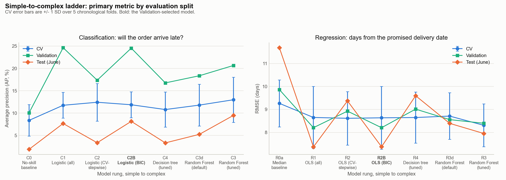
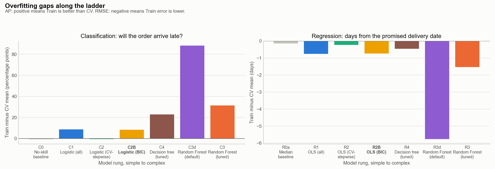
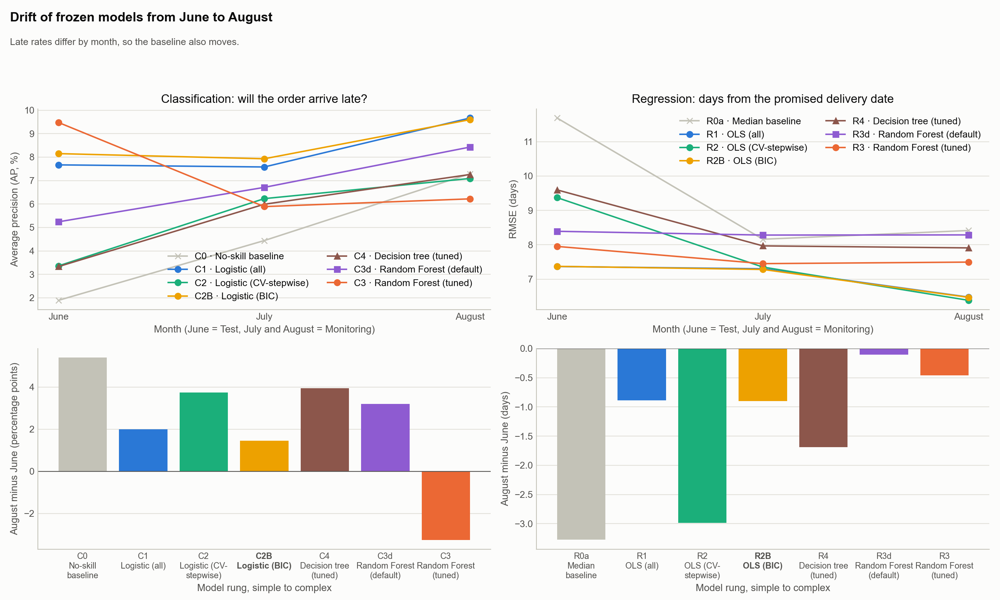
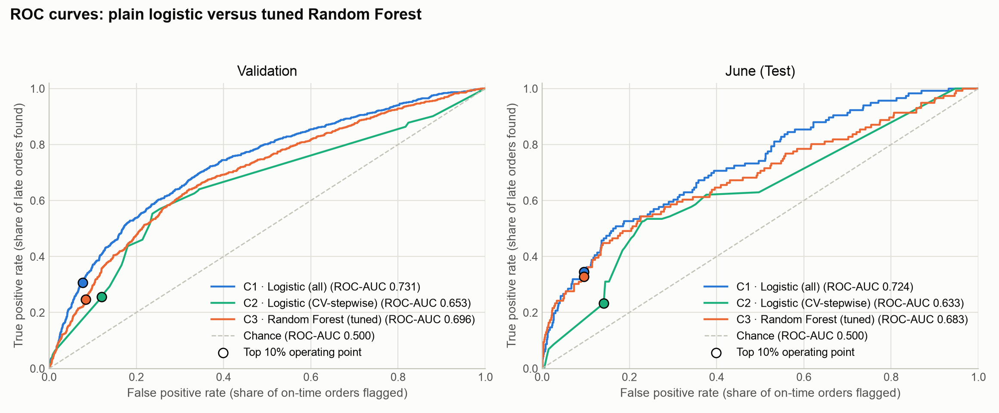
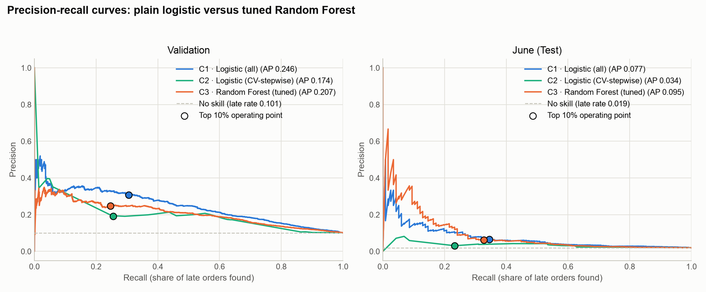
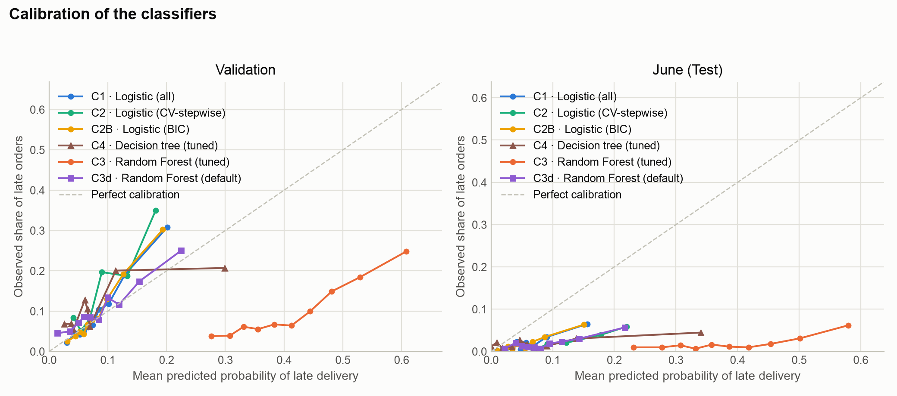
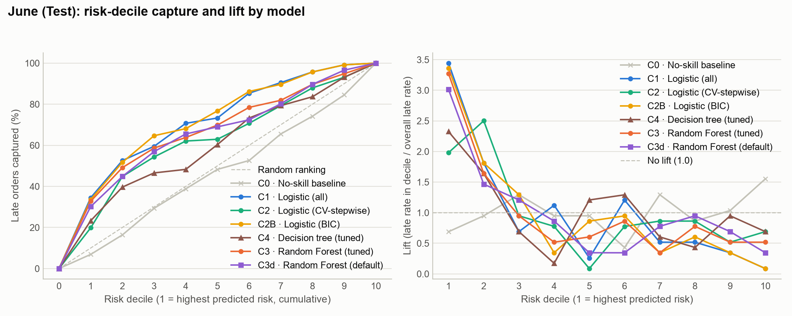
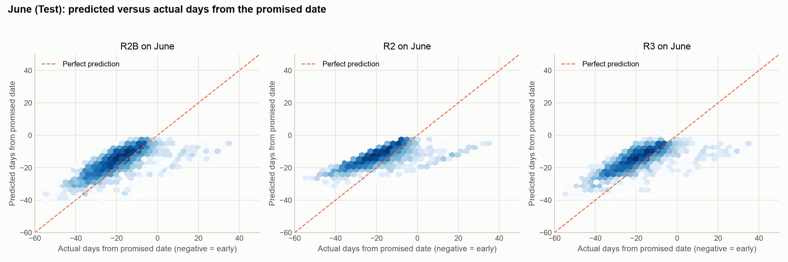
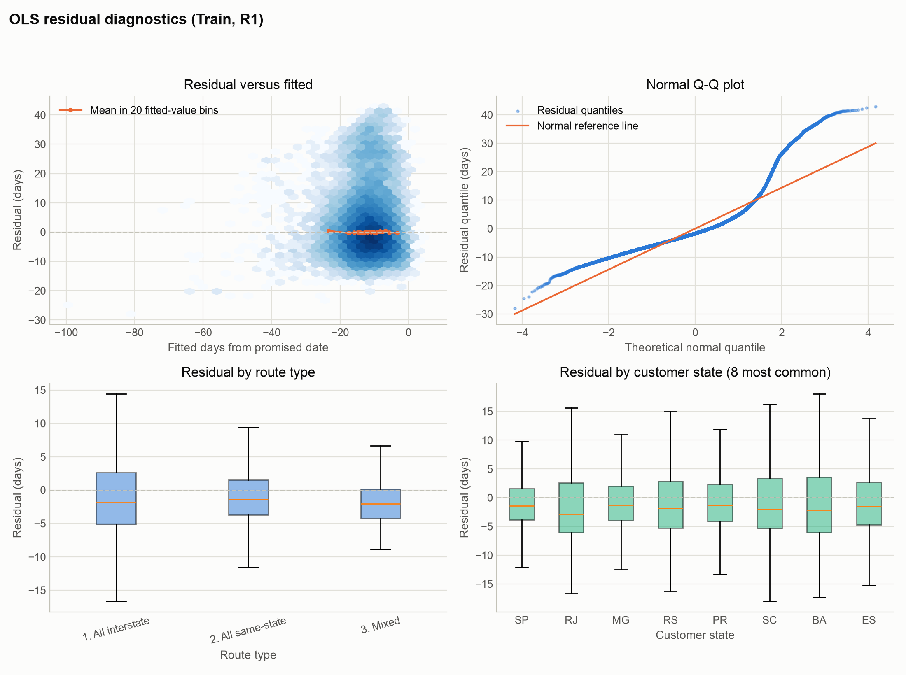

# Results summary: simple to complex

Generated by `python -m src.summary` from the exported tables and metadata only; nothing is refitted. Protocol: Train (in-sample), CV (5 chronological folds inside Train), Validation (30-day out-of-time holdout), Test (June) and Monitoring (July, August) scored by frozen models. CV tunes and selects features inside each family; Validation alone chooses between models (day-level bootstrap against the Validation leader; the simplest model with no clear difference wins, which does not establish equivalence); June outcomes never enter a choice; because June was examined previously, its results are a retrospective test assessment. Canceled and unavailable orders are excluded from both tasks. Primary metrics: AP for classification, RMSE for regression.

**Selected models: C2B · Logistic (BIC) and R2B · OLS (BIC).**

## Model key

Codes are the stable keys used in every table, figure and export; the report should write "Code · short label" (for example "C2 · Logistic (CV-stepwise)") on first mention. Features is the number of raw features the model uses.

**Classification: will the order arrive late?**

| Code | Model | Description | Features |
|---|---|---|---|
| C0 | No-skill baseline | Predicts the Train late rate for every order | - |
| C1 | Logistic (all) | Plain logistic regression, all 24 features, pre-specified transforms | 24 |
| C2 | Logistic (CV-stepwise) | Plain logistic, features chosen by CV forward stepwise with the 1-SE rule | 1 |
| C2B | Logistic (BIC) | Plain logistic, features chosen by BIC forward stepwise | 13 |
| C4 | Decision tree (tuned) | Single decision tree, raw 24 features, depth, leaf size and split rule tuned by CV grid search | 24 |
| C3 | Random Forest (tuned) | Random Forest, raw 24 features, hyperparameters tuned by two-stage CV search | 24 |
| C3d | Random Forest (default) | Random Forest, raw 24 features, scikit-learn default hyperparameters | 24 |

**Regression: days from the promised delivery date**

| Code | Model | Description | Features |
|---|---|---|---|
| R0a | Median baseline | Predicts the Train median days from promise for every order | - |
| R0b | Olist promise | Predicts arrival exactly on the promised date (0 days), with the lead time capped at 45 days | - |
| R1 | OLS (all) | Ordinary least squares, all 24 features, pre-specified transforms | 24 |
| R2 | OLS (CV-stepwise) | OLS, features chosen by CV forward stepwise with the 1-SE rule | 1 |
| R2B | OLS (BIC) | OLS, features chosen by BIC forward stepwise | 17 |
| R4 | Decision tree (tuned) | Single decision tree, raw 24 features, depth and leaf size tuned by CV grid search on RMSE | 24 |
| R3 | Random Forest (tuned) | Random Forest, raw 24 features, hyperparameters tuned by two-stage CV search on RMSE | 24 |
| R3d | Random Forest (default) | Random Forest, raw 24 features, scikit-learn default hyperparameters | 24 |

## 1. The simple-to-complex ladder

**Classification: will the order arrive late?** (Average precision (AP, %))

| Rung | Code | Model | CV mean +/- SD | Validation | Test (June) |
|---|---|---|---|---|---|
| Baseline | C0 | No-skill baseline | 8.37 +/- 3.51 | 10.06 | 1.89 |
| Linear, all | C1 | Logistic (all) | 11.75 +/- 2.89 | 24.63 | 7.67 |
| Linear, CV-stepwise | C2 | Logistic (CV-stepwise) | 12.42 +/- 4.21 | 17.36 | 3.36 |
| Linear, BIC | C2B | Logistic (BIC) | 11.86 +/- 2.89 | 24.53 | 8.15 |
| Single tree | C4 | Decision tree (tuned) | 10.79 +/- 3.94 | 16.76 | 3.33 |
| RF, default | C3d | Random Forest (default) | 11.79 +/- 4.68 | 18.36 | 5.24 |
| RF, tuned | C3 | Random Forest (tuned) | 12.98 +/- 5.06 | 20.66 | 9.48 |

**Regression: days from the promised delivery date** (RMSE (days))

| Rung | Code | Model | CV mean +/- SD | Validation | Test (June) |
|---|---|---|---|---|---|
| Baseline | R0a | Median baseline | 9.27 +/- 1.02 | 9.86 | 11.69 |
| Linear, all | R1 | OLS (all) | 8.65 +/- 1.35 | 8.21 | 7.37 |
| Linear, CV-stepwise | R2 | OLS (CV-stepwise) | 8.61 +/- 1.16 | 8.93 | 9.37 |
| Linear, BIC | R2B | OLS (BIC) | 8.64 +/- 1.37 | 8.20 | 7.37 |
| Single tree | R4 | Decision tree (tuned) | 8.65 +/- 1.11 | 9.01 | 9.60 |
| RF, default | R3d | Random Forest (default) | 8.71 +/- 1.01 | 8.56 | 8.39 |
| RF, tuned | R3 | Random Forest (tuned) | 8.31 +/- 0.93 | 8.40 | 7.95 |

## 2. Classification: will the order arrive late?

### 2.1 Row counts per split

| Split | Orders | Late orders | Late rate (%) | First approval | Last approval |
|---|---|---|---|---|---|
| Train | 45368 | 3457 | 7.62 | 2017-04-18 | 2018-02-01 |
| Validation | 6846 | 689 | 10.06 | 2018-03-19 | 2018-04-17 |
| History before 2 June (June refit) | 62840 | 6211 | 9.88 | 2017-04-18 | 2018-04-17 |

Frozen models score the Test and Monitoring months:

| Evaluation split | Orders scored |
|---|---|
| Test (June) | 6,142 |
| Monitoring (July) | 6,078 |
| Monitoring (August) | 6,561 |

### 2.2 Transformations (pre-specified, linear models)

Every linear model uses the same pre-specified design, fixed from the predictors' distributions and the cyclic nature of month and weekday. None of it is tuned on the outcome.

- **log1p on 8 skewed inputs:** `payment_value_sum`, `order_frieght_value_sum`, `order_product_weight_g_sum`, `order_product_volume_cm3_sum`, `approval_lag_hours`, `seller_dist_km_mean`, `freight_to_price_ratio`, `orders_approved_prev_7d`. They are non-negative with long right tails (|skew| from 1.7 to 11.3 on Train). log1p compresses the tail so a few extreme orders do not dominate a linear fit, handles zeros, and gives per-doubling effects. Only the predictors' distribution on Train was used, never the outcome, so there is no selection optimism; pre-specifying transformations is recommended by Harrell, *Regression Modeling Strategies*.
- **Sine and cosine for month and weekday.** They are cyclic (December is next to January, Sunday next to Monday); a plain number imposes a false straight-line order and a jump at the wrap-around. Dummies would be exactly collinear with the weekend and December flags, and a sine/cosine pair captures a smooth cycle in two columns.
- **Mixed route** is folded into All interstate (every mixed-route order has an interstate leg).
- **No squared terms.** Choosing polynomial terms by looking at the outcome would be another data-driven selection step. Each coefficient stays a single, interpretable slope, and remaining nonlinearity is judged by the Random Forest stage. The curvature plots in the notebooks are a diagnostic only.
- **Why not other transformations?**
  - *Exponential and other expanding transforms (squares, powers above 1).* The skewed inputs already have long right tails; an expanding transform stretches the tail further and gives a few extreme orders even more leverage in a linear fit, the opposite of what is needed. It is also numerically unstable on money and volume values (exp of a payment value overflows).
  - *Quadratic and polynomial terms.* Choosing curvature terms by looking at the outcome is a second outcome-driven selection step, which adds optimism (specification search). The curvature diagnostic shows no strong curvature remains, and any remaining nonlinearity is tested by the Random Forest stage.
  - *Box-Cox and Yeo-Johnson.* These estimate a power per feature from the data. log1p is the simplest member of that family (Box-Cox lambda = 0, shifted by 1 to handle zeros) and gives readable "per doubling" effects. Fitting a lambda per feature adds parameters and makes coefficients harder to interpret, for little expected gain once the log has already reduced the skew.
  - *Splines and binning.* These are flexible, outcome-shaped terms. Flexible nonlinearity is exactly what the Random Forest stage is for, so the linear stage stays a simple, interpretable baseline.
  - *Principle.* Transformations are chosen from each input's distribution and for interpretability, not by searching over transformation families against the outcome, so variable selection remains the only outcome-driven step.

Rule: pre-specified. Variable selection is the only outcome-driven step. The Random Forest uses the raw features.

### 2.3 Stepwise path, chosen step and selected variables

The best CV step is 10 and the 1-SE rule chooses step 1, which gives C2 with 1 variable(s): customer_state.

| Step | Added unit | Units | Encoded columns | CV mean | CV SE | Marker |
|---|---|---|---|---|---|---|
| 0 | (intercept only) | 0 | 0 | 0.0837 | 0.0157 |  |
| 1 | customer_state | 1 | 26 | 0.1242 | 0.0188 | 1-SE choice |
| 2 | promised_lead_days | 2 | 27 | 0.1314 | 0.0177 |  |
| 3 | route_type | 3 | 28 | 0.1328 | 0.0181 |  |
| 4 | order_seller_count | 4 | 29 | 0.1339 | 0.0181 |  |
| 5 | order_product_weight_g_sum | 5 | 30 | 0.1351 | 0.0185 |  |
| 6 | order_approved_day_of_month | 6 | 31 | 0.1361 | 0.0197 |  |
| 7 | order_approved_day_of_week | 7 | 33 | 0.1363 | 0.0196 |  |
| 8 | approval_lag_hours | 8 | 34 | 0.1364 | 0.0185 |  |
| 9 | seller_state_count | 9 | 35 | 0.1365 | 0.0185 |  |
| 10 | is_black_friday_period | 10 | 36 | 0.1365 | 0.0185 | best CV step |
| 11 | is_december_peak | 11 | 37 | 0.1365 | 0.0185 |  |
| 12 | order_product_category_count | 12 | 38 | 0.1364 | 0.0186 |  |
| 13 | order_item_count | 13 | 39 | 0.1362 | 0.0186 |  |
| 14 | order_frieght_value_sum | 14 | 40 | 0.136 | 0.019 |  |
| 15 | is_weekend_approval | 15 | 41 | 0.1362 | 0.0187 |  |
| 16 | payment_combination | 16 | 45 | 0.136 | 0.0187 |  |
| 17 | order_product_volume_cm3_sum | 17 | 46 | 0.1359 | 0.0189 |  |
| 18 | freight_to_price_ratio | 18 | 47 | 0.1357 | 0.0188 |  |
| 19 | order_product_photos_mean | 19 | 48 | 0.1353 | 0.0186 |  |
| 20 | payment_installments_max | 20 | 49 | 0.1345 | 0.0187 |  |
| 21 | payment_value_sum | 21 | 50 | 0.1342 | 0.0178 |  |
| 22 | seller_dist_km_mean | 22 | 51 | 0.1324 | 0.0181 |  |
| 23 | order_approved_month | 23 | 53 | 0.1263 | 0.0185 |  |
| 24 | orders_approved_prev_7d | 24 | 54 | 0.1175 | 0.0129 |  |

### 2.4 Selection overlap: CV-stepwise, BIC, AIC and Lasso

| Method or model | Variables selected |
|---|---|
| C2 · Logistic (CV-stepwise) | 1 |
| C2B · Logistic (BIC) | 13 |
| AIC | 20 |
| Lasso | 24 |

| Unit | CV-stepwise | CV step entered | BIC | AIC | Lasso | Methods choosing it |
|---|---|---|---|---|---|---|
| customer_state | yes | 1 | yes | yes | yes | 4 |
| promised_lead_days |  | 2 | yes | yes | yes | 3 |
| route_type |  | 3 | yes | yes | yes | 3 |
| order_seller_count |  | 4 | yes | yes | yes | 3 |
| approval_lag_hours |  | 8 | yes | yes | yes | 3 |
| is_black_friday_period |  | 10 | yes | yes | yes | 3 |
| is_december_peak |  | 11 | yes | yes | yes | 3 |
| order_item_count |  | 13 | yes | yes | yes | 3 |
| order_product_volume_cm3_sum |  | 17 | yes | yes | yes | 3 |
| payment_value_sum |  | 21 | yes | yes | yes | 3 |
| seller_dist_km_mean |  | 22 | yes | yes | yes | 3 |
| order_approved_month |  | 23 | yes | yes | yes | 3 |
| orders_approved_prev_7d |  | 24 | yes | yes | yes | 3 |
| order_approved_day_of_month |  | 6 |  | yes | yes | 2 |
| order_approved_day_of_week |  | 7 |  | yes | yes | 2 |
| seller_state_count |  | 9 |  | yes | yes | 2 |
| is_weekend_approval |  | 15 |  | yes | yes | 2 |
| payment_combination |  | 16 |  | yes | yes | 2 |
| freight_to_price_ratio |  | 18 |  | yes | yes | 2 |
| order_product_photos_mean |  | 19 |  | yes | yes | 2 |
| order_product_weight_g_sum |  | 5 |  |  | yes | 1 |
| order_product_category_count |  | 12 |  |  | yes | 1 |
| order_frieght_value_sum |  | 14 |  |  | yes | 1 |
| payment_installments_max |  | 20 |  |  | yes | 1 |

### 2.5 Random Forest search and sensitivity

Stage A drew 60 random candidates from this space.

| parameter | values searched (Stage A) |
|---|---|
| max_depth | None, 6, 8, 10, 12, 16, 20, 30 |
| min_samples_leaf | 1, 2, 5, 10, 20, 50, 100, 200 |
| min_samples_split | 2, 5, 10, 20, 50 |
| max_features | log2, sqrt, 0.2, 0.3, 0.5, 0.7, 1.0 |
| max_samples | None, 0.5, 0.7, 0.9 |
| class_weight | None, balanced, balanced_subsample |
| criterion | gini, entropy |

| Item | Value |
|---|---|
| Stage A candidates | 60 |
| Stage A trees | 200 |
| Stage B candidates | 54 |
| Stage B trees | 300 or 500 |
| Best CV AP (mean +/- SD) | 0.1298 +/- 0.0453 |
| Stage A best CV AP | 0.1292 |
| Search time (Stage A + B, s) | 298 |
| Best parameters | {"min_samples_split": 10, "max_samples": 0.5, "criterion": "gini", "class_weight": "balanced", "max_depth": 12, "min_samples_leaf": 5, "max_features": "sqrt", "n_estimators": 500} |

Sensitivity of the Stage A search (spread = best minus worst score over the values of one hyperparameter; a larger spread means the score is more sensitive to that hyperparameter):

| Hyperparameter | Best value | Best candidate score | Worst value | Worst candidate score | Spread |
|---|---|---|---|---|---|
| min_samples_leaf | 10 | 0.1292 | 200 | 0.1198 | 0.0094 |
| max_features | 0.2 | 0.1292 | 1.0 | 0.1242 | 0.0050 |
| max_depth | 16.0 | 0.1292 | 12.0 | 0.1242 | 0.0050 |
| max_samples | 0.5 | 0.1292 | 0.7 | 0.1254 | 0.0038 |
| min_samples_split | 10 | 0.1292 | 20 | 0.1255 | 0.0037 |
| class_weight | balanced | 0.1292 | balanced_subsample | 0.1271 | 0.0021 |
| criterion | gini | 0.1292 | entropy | 0.1273 | 0.0019 |

### 2.6 Evaluation tables (Train, CV, Validation, Test (June), Monitoring)

**Classification: Average precision (%)**

| Code | Model | Train | CV mean +/- SD | Validation | Test (June) | July | August |
|---|---|---|---|---|---|---|---|
| C0 | No-skill baseline | 7.62 | 8.37 +/- 3.51 | 10.06 | 1.89 | 4.44 | 7.29 |
| C1 | Logistic (all) | 20.39 | 11.75 +/- 2.89 | 24.63 | 7.67 | 7.58 | 9.67 |
| C2 | Logistic (CV-stepwise) | 11.88 | 12.42 +/- 4.21 | 17.36 | 3.36 | 6.23 | 7.09 |
| C2B | Logistic (BIC) | 20.22 | 11.86 +/- 2.89 | 24.53 | 8.15 | 7.93 | 9.60 |
| C3 | Random Forest (tuned) | 44.31 | 12.98 +/- 5.06 | 20.66 | 9.48 | 5.89 | 6.22 |
| C3d | Random Forest (default) | 100.00 | 11.79 +/- 4.68 | 18.36 | 5.24 | 6.71 | 8.43 |
| C4 | Decision tree (tuned) | 33.57 | 10.79 +/- 3.94 | 16.76 | 3.33 | 5.99 | 7.26 |

**Classification: ROC-AUC**

| Code | Model | Train | CV mean +/- SD | Validation | Test (June) | July | August |
|---|---|---|---|---|---|---|---|
| C0 | No-skill baseline | 0.500 | 0.500 +/- 0.000 | 0.500 | 0.500 | 0.500 | 0.500 |
| C1 | Logistic (all) | 0.699 | 0.603 +/- 0.042 | 0.731 | 0.724 | 0.588 | 0.548 |
| C2 | Logistic (CV-stepwise) | 0.632 | 0.610 +/- 0.028 | 0.653 | 0.633 | 0.547 | 0.435 |
| C2B | Logistic (BIC) | 0.697 | 0.601 +/- 0.042 | 0.730 | 0.729 | 0.591 | 0.560 |
| C3 | Random Forest (tuned) | 0.886 | 0.618 +/- 0.023 | 0.696 | 0.683 | 0.566 | 0.389 |
| C3d | Random Forest (default) | 1.000 | 0.587 +/- 0.029 | 0.665 | 0.663 | 0.600 | 0.563 |
| C4 | Decision tree (tuned) | 0.776 | 0.540 +/- 0.044 | 0.624 | 0.605 | 0.539 | 0.488 |

**Classification: Brier score (lower is better)**

| Code | Model | Train | CV mean +/- SD | Validation | Test (June) | July | August |
|---|---|---|---|---|---|---|---|
| C0 | No-skill baseline | 0.070 | 0.077 +/- 0.031 | 0.091 | 0.025 | 0.045 | 0.068 |
| C1 | Logistic (all) | 0.066 | 0.077 +/- 0.030 | 0.085 | 0.020 | 0.045 | 0.071 |
| C2 | Logistic (CV-stepwise) | 0.069 | 0.077 +/- 0.031 | 0.088 | 0.026 | 0.047 | 0.071 |
| C2B | Logistic (BIC) | 0.066 | 0.077 +/- 0.030 | 0.085 | 0.020 | 0.044 | 0.070 |
| C3 | Random Forest (tuned) | 0.169 | 0.188 +/- 0.032 | 0.185 | 0.160 | 0.189 | 0.242 |
| C3d | Random Forest (default) | 0.009 | 0.077 +/- 0.027 | 0.088 | 0.024 | 0.052 | 0.086 |
| C4 | Decision tree (tuned) | 0.060 | 0.080 +/- 0.032 | 0.091 | 0.031 | 0.059 | 0.115 |

**Classification: Top-10% precision (%)**

| Code | Model | Train | CV mean +/- SD | Validation | Test (June) | July | August |
|---|---|---|---|---|---|---|---|
| C0 | No-skill baseline | 7.16 | 7.43 +/- 4.37 | 9.34 | 1.30 | 2.80 | 7.00 |
| C1 | Logistic (all) | 24.36 | 12.77 +/- 2.59 | 30.80 | 6.50 | 8.72 | 9.28 |
| C2 | Logistic (CV-stepwise) | 14.90 | 12.63 +/- 3.56 | 19.85 | 3.74 | 6.09 | 6.24 |
| C2B | Logistic (BIC) | 24.29 | 12.95 +/- 2.81 | 30.22 | 6.34 | 8.72 | 9.44 |
| C3 | Random Forest (tuned) | 39.10 | 15.50 +/- 6.04 | 24.82 | 6.18 | 7.07 | 7.00 |
| C3d | Random Forest (default) | 76.20 | 13.28 +/- 5.49 | 24.53 | 5.69 | 7.73 | 8.07 |
| C4 | Decision tree (tuned) | 34.10 | 14.45 +/- 7.21 | 20.58 | 4.39 | 6.41 | 6.85 |

**Classification: Top-10% capture of late orders**

| Code | Model | Train | CV mean +/- SD | Validation | Test (June) | July | August |
|---|---|---|---|---|---|---|---|
| C0 | No-skill baseline | 0.094 | 0.092 +/- 0.047 | 0.093 | 0.069 | 0.063 | 0.096 |
| C1 | Logistic (all) | 0.320 | 0.166 +/- 0.053 | 0.306 | 0.345 | 0.196 | 0.128 |
| C2 | Logistic (CV-stepwise) | 0.196 | 0.163 +/- 0.059 | 0.197 | 0.198 | 0.137 | 0.086 |
| C2B | Logistic (BIC) | 0.319 | 0.168 +/- 0.056 | 0.300 | 0.336 | 0.196 | 0.130 |
| C3 | Random Forest (tuned) | 0.513 | 0.189 +/- 0.044 | 0.247 | 0.328 | 0.159 | 0.096 |
| C3d | Random Forest (default) | 1.000 | 0.161 +/- 0.024 | 0.244 | 0.302 | 0.174 | 0.111 |
| C4 | Decision tree (tuned) | 0.447 | 0.177 +/- 0.074 | 0.205 | 0.233 | 0.144 | 0.094 |

**Classification: Top-10% lift**

| Code | Model | Train | CV mean +/- SD | Validation | Test (June) | July | August |
|---|---|---|---|---|---|---|---|
| C0 | No-skill baseline | 0.940 | 0.923 +/- 0.471 | 0.928 | 0.689 | 0.629 | 0.961 |
| C1 | Logistic (all) | 3.196 | 1.662 +/- 0.525 | 3.061 | 3.444 | 1.962 | 1.274 |
| C2 | Logistic (CV-stepwise) | 1.955 | 1.630 +/- 0.588 | 1.973 | 1.980 | 1.370 | 0.857 |
| C2B | Logistic (BIC) | 3.188 | 1.683 +/- 0.557 | 3.003 | 3.358 | 1.962 | 1.295 |
| C3 | Random Forest (tuned) | 5.131 | 1.889 +/- 0.445 | 2.466 | 3.272 | 1.592 | 0.961 |
| C3d | Random Forest (default) | 10.000 | 1.605 +/- 0.241 | 2.437 | 3.013 | 1.740 | 1.107 |
| C4 | Decision tree (tuned) | 4.475 | 1.765 +/- 0.743 | 2.045 | 2.325 | 1.444 | 0.940 |

### 2.7 Model choice on Validation (day-level bootstrap)

Rule: Validation leader; day-level bootstrap (2,000) of each model minus leader; tied if the 95% interval includes 0; simplest tied model (linear < tree < forest, then fewer parameters).

**Selected: C2B · Logistic (BIC)** (order-level bootstrap sensitivity selects C2B).

| Code | Model | validation | diff_vs_leader | ci_low | ci_high | leader | tied | family | parameters | selected | decision | order_ci_low | order_ci_high | order_tied |
|---|---|---|---|---|---|---|---|---|---|---|---|---|---|---|
| C0 | No-skill baseline | 0.1006 | -0.1457 | -0.1759 | -0.1218 | False | False |  |  | False | baseline: not selectable | -0.1736 | -0.1213 | False |
| C1 | Logistic (all) | 0.2463 | 0.0 | 0.0 | 0.0 | True | True | linear | 55.0 | False | tied, but a simpler tied model exists | 0.0 | 0.0 | True |
| C2 | Logistic (CV-stepwise) | 0.1736 | -0.0728 | -0.0924 | -0.0574 | False | False | linear | 27.0 | False | not tied: interval excludes 0 | -0.0913 | -0.0563 | False |
| C2B | Logistic (BIC) | 0.2453 | -0.001 | -0.0072 | 0.0044 | False | True | linear | 40.0 | True | selected: simplest model tied with the leader | -0.0077 | 0.0048 | True |
| C4 | Decision tree (tuned) | 0.1676 | -0.0788 | -0.101 | -0.0585 | False | False | tree | 344.0 | False | not tied: interval excludes 0 | -0.1051 | -0.0561 | False |
| C3 | Random Forest (tuned) | 0.2066 | -0.0398 | -0.0654 | -0.0155 | False | False | forest | 228205.0 | False | not tied: interval excludes 0 | -0.0603 | -0.0202 | False |
| C3d | Random Forest (default) | 0.1836 | -0.0628 | -0.0893 | -0.0385 | False | False | forest | 417589.0 | False | not tied: interval excludes 0 | -0.0839 | -0.0413 | False |

**Refit check on Test (June): the selected specification fitted on Train only versus refitted on history**

| C2B | AP | ROC-AUC | Brier score | Top-10% precision | Top-10% lift | n_known |
|---|---|---|---|---|---|---|
| Fitted on Train only | 0.0712 | 0.7547 | 0.019 | 0.065 | 3.4438 | 6134 |
| Refitted on history before 2 June | 0.0815 | 0.7294 | 0.0198 | 0.0634 | 3.3577 | 6134 |

### 2.8 Success criteria

| Code | Model | Split | Criterion | Value | Threshold | Result |
|---|---|---|---|---|---|---|
| C1 | Logistic (all) | June | Top-10% lift >= 2 | 3.444 | 2.0 | pass |
| C2 | Logistic (CV-stepwise) | June | Top-10% lift >= 2 | 1.98 | 2.0 | fail |
| C2B | Logistic (BIC) | June | Top-10% lift >= 2 | 3.358 | 2.0 | pass |
| C4 | Decision tree (tuned) | June | Top-10% lift >= 2 | 2.325 | 2.0 | pass |
| C3 | Random Forest (tuned) | June | Top-10% lift >= 2 | 3.272 | 2.0 | pass |
| C3d | Random Forest (default) | June | Top-10% lift >= 2 | 3.013 | 2.0 | pass |
| C4 | Decision tree (tuned) | June | Top-10% precision >= 1.1 x best linear (C1) | 0.044 | 0.072 | fail |
| C3 | Random Forest (tuned) | June | Top-10% precision >= 1.1 x best linear (C1) | 0.062 | 0.072 | fail |
| C3d | Random Forest (default) | June | Top-10% precision >= 1.1 x best linear (C1) | 0.057 | 0.072 | fail |
| C1 | Logistic (all) | Validation | Top-10% lift >= 2 | 3.061 | 2.0 | pass |
| C2 | Logistic (CV-stepwise) | Validation | Top-10% lift >= 2 | 1.973 | 2.0 | fail |
| C2B | Logistic (BIC) | Validation | Top-10% lift >= 2 | 3.003 | 2.0 | pass |
| C4 | Decision tree (tuned) | Validation | Top-10% lift >= 2 | 2.045 | 2.0 | pass |
| C3 | Random Forest (tuned) | Validation | Top-10% lift >= 2 | 2.466 | 2.0 | pass |
| C3d | Random Forest (default) | Validation | Top-10% lift >= 2 | 2.437 | 2.0 | pass |
| C4 | Decision tree (tuned) | Validation | Top-10% precision >= 1.1 x best linear (C1) | 0.206 | 0.339 | fail |
| C3 | Random Forest (tuned) | Validation | Top-10% precision >= 1.1 x best linear (C1) | 0.248 | 0.339 | fail |
| C3d | Random Forest (default) | Validation | Top-10% precision >= 1.1 x best linear (C1) | 0.245 | 0.339 | fail |

### 2.9 Overfitting gaps (Train minus CV mean)

| Code | Model | AP | ROC-AUC | Brier score | Top-10% precision | Top-10% lift |
|---|---|---|---|---|---|---|
| C0 | No-skill baseline | -0.0075 | 0.0 | -0.0071 | -0.0027 | 0.0168 |
| C1 | Logistic (all) | 0.0864 | 0.0962 | -0.0104 | 0.1158 | 1.5347 |
| C2 | Logistic (CV-stepwise) | -0.0054 | 0.0224 | -0.008 | 0.0227 | 0.3249 |
| C2B | Logistic (BIC) | 0.0835 | 0.0956 | -0.0103 | 0.1134 | 1.5044 |
| C4 | Decision tree (tuned) | 0.2278 | 0.2356 | -0.0208 | 0.1965 | 2.7094 |
| C3 | Random Forest (tuned) | 0.3132 | 0.2677 | -0.0197 | 0.236 | 3.2428 |
| C3d | Random Forest (default) | 0.8821 | 0.4134 | -0.0675 | 0.6292 | 8.3948 |

### 2.10 Random Forest tuning gain (tuned minus default)

| Metric | CV: C3 | CV: C3d | CV: gain | Validation: C3 | Validation: C3d | Validation: gain | June: C3 | June: C3d | June: gain | Train - CV gap: C3 | Train - CV gap: C3d |
|---|---|---|---|---|---|---|---|---|---|---|---|
| AP | 0.1298 | 0.1179 | 0.012 | 0.2066 | 0.1836 | 0.023 | 0.0948 | 0.0524 | 0.0425 | 0.3132 | 0.8821 |
| ROC-AUC | 0.618 | 0.5866 | 0.0314 | 0.6957 | 0.6645 | 0.0312 | 0.6828 | 0.6628 | 0.0201 | 0.2677 | 0.4134 |
| Brier score | 0.1883 | 0.0768 | 0.1115 | 0.1848 | 0.0875 | 0.0973 | 0.1597 | 0.0244 | 0.1353 | -0.0197 | -0.0675 |
| Top-10% precision | 0.155 | 0.1328 | 0.0222 | 0.2482 | 0.2453 | 0.0029 | 0.0618 | 0.0569 | 0.0049 | 0.236 | 0.6292 |
| Top-10% lift | 1.8886 | 1.6048 | 0.2838 | 2.4659 | 2.4369 | 0.029 | 3.2716 | 3.0133 | 0.2583 | 3.2428 | 8.3948 |

### 2.11 Fold-wise CV differences: tuned vs default forest, forest vs single tree

| comparison | Metric | mean_diff | sd_diff | ci_low | ci_high | folds_better | fold_diffs |
|---|---|---|---|---|---|---|---|
| C3 - C3d | AP | 0.011972232493448606 | 0.004795980997811141 | 0.0024001170788180426 | 0.02154434790807917 | 5/5 | +0.0148, +0.0065, +0.0172, +0.0141, +0.0073 |
| C3 - C4 | AP | 0.021915291019486666 | 0.03413360854904652 | -0.04621067543000759 | 0.09004125746898092 | 4/5 | +0.0305, +0.0136, +0.0671, -0.0277, +0.0260 |
| C3d - C4 | AP | 0.00994305852603806 | 0.033142989578488734 | -0.056205769331283024 | 0.07609188638335915 | 4/5 | +0.0157, +0.0071, +0.0499, -0.0418, +0.0188 |

### 2.12 Top odds ratios with 95% CIs

**C1: largest effects**

| Term | Scale | OR | 95% CI | p-value |
|---|---|---|---|---|
| customer_state_AL | vs reference level | 6.152 | 4.319 to 8.762 | <0.001 |
| customer_state_RR | vs reference level | 5.266 | 1.141 to 24.313 | 0.033 |
| customer_state_MA | vs reference level | 3.299 | 2.419 to 4.499 | <0.001 |
| customer_state_PB | vs reference level | 3.179 | 2.158 to 4.683 | <0.001 |
| customer_state_SE | vs reference level | 3.157 | 2.008 to 4.963 | <0.001 |
| customer_state_RJ | vs reference level | 2.472 | 2.180 to 2.804 | <0.001 |
| customer_state_PE | vs reference level | 2.413 | 1.865 to 3.122 | <0.001 |
| customer_state_BA | vs reference level | 2.267 | 1.866 to 2.755 | <0.001 |

seller_state_count: NOT IDENTIFIED (quasi-separation).

**C2: largest effects**

| Term | Scale | OR | 95% CI | p-value |
|---|---|---|---|---|
| customer_state_AL | vs reference level | 5.77 | 4.187 to 7.952 | <0.001 |
| customer_state_MA | vs reference level | 3.482 | 2.647 to 4.581 | <0.001 |
| customer_state_SE | vs reference level | 3.243 | 2.122 to 4.956 | <0.001 |
| customer_state_PB | vs reference level | 2.968 | 2.082 to 4.233 | <0.001 |
| customer_state_RR | vs reference level | 2.848 | 0.637 to 12.742 | 0.171 |
| customer_state_RJ | vs reference level | 2.778 | 2.523 to 3.058 | <0.001 |
| customer_state_PI | vs reference level | 2.489 | 1.688 to 3.669 | <0.001 |
| customer_state_RO | vs reference level | 0.42 | 0.133 to 1.323 | 0.139 |

### 2.13 Hypothesis check

| Code | Model | Hypothesis | Feature | Expected sign | Term | Coefficient | p-value | Observed sign | Verdict |
|---|---|---|---|---|---|---|---|---|---|
| C1 | Logistic (all) | time | is_weekend_approval | + | is_weekend_approval | -0.084 | 0.0039 | - | disagree |
| C1 | Logistic (all) | time | is_black_friday_period | + | is_black_friday_period | 0.276 | 0.0 | + | agree |
| C1 | Logistic (all) | time | is_december_peak | + | is_december_peak | 0.135 | 0.0 | + | agree |
| C1 | Logistic (all) | workload | orders_approved_prev_7d | + | log_orders_approved_prev_7d | 0.107 | 0.0001 | + | agree |
| C1 | Logistic (all) | workload | approval_lag_hours | + | log_approval_lag_hours | 0.15 | 0.0 | + | agree |
| C1 | Logistic (all) | order | order_item_count | + | order_item_count | -0.1 | 0.0001 | - | disagree |
| C1 | Logistic (all) | order | order_seller_count | + | order_seller_count | -0.154 | 0.0018 | - | disagree |
| C1 | Logistic (all) | order | order_product_weight_g_sum | + | log_order_product_weight_g_sum | 0.008 | 0.8235 | + | not significant |
| C1 | Logistic (all) | order | order_product_volume_cm3_sum | + | log_order_product_volume_cm3_sum | 0.076 | 0.0096 | + | agree |
| C1 | Logistic (all) | distance | seller_dist_km_mean | + | log_seller_dist_km_mean | 0.139 | 0.0001 | + | agree |
| C1 | Logistic (all) | distance | seller_state_count | + | seller_state_count | -1.139 | 0.9892 | - | not identified |
| C1 | Logistic (all) | payment | payment_installments_max | + | payment_installments_max | 0.019 | 0.3691 | + | not significant |
| C1 | Logistic (all) | payment | payment_value_sum | + | log_payment_value_sum | 0.116 | 0.0076 | + | agree |
| C1 | Logistic (all) | promise | promised_lead_days | - | promised_lead_days | -0.371 | 0.0 | - | agree |
| C2 | Logistic (CV-stepwise) | time | is_weekend_approval | + |  |  |  |  | not in model |
| C2 | Logistic (CV-stepwise) | time | is_black_friday_period | + |  |  |  |  | not in model |
| C2 | Logistic (CV-stepwise) | time | is_december_peak | + |  |  |  |  | not in model |
| C2 | Logistic (CV-stepwise) | workload | orders_approved_prev_7d | + |  |  |  |  | not in model |
| C2 | Logistic (CV-stepwise) | workload | approval_lag_hours | + |  |  |  |  | not in model |
| C2 | Logistic (CV-stepwise) | order | order_item_count | + |  |  |  |  | not in model |
| C2 | Logistic (CV-stepwise) | order | order_seller_count | + |  |  |  |  | not in model |
| C2 | Logistic (CV-stepwise) | order | order_product_weight_g_sum | + |  |  |  |  | not in model |
| C2 | Logistic (CV-stepwise) | order | order_product_volume_cm3_sum | + |  |  |  |  | not in model |
| C2 | Logistic (CV-stepwise) | distance | seller_dist_km_mean | + |  |  |  |  | not in model |
| C2 | Logistic (CV-stepwise) | distance | seller_state_count | + |  |  |  |  | not in model |
| C2 | Logistic (CV-stepwise) | payment | payment_installments_max | + |  |  |  |  | not in model |
| C2 | Logistic (CV-stepwise) | payment | payment_value_sum | + |  |  |  |  | not in model |
| C2 | Logistic (CV-stepwise) | promise | promised_lead_days | - |  |  |  |  | not in model |

### 2.14 Random Forest top features

**Top 10 by permutation importance on Validation, with linear-model significance**

| Rank | Feature | Importance (mean) | Smallest linear p-value | Significant in linear model |
|---|---|---|---|---|
| 1 | customer_state | 0.0407 | 0.0 | True |
| 2 | seller_dist_km_mean | 0.0266 | 0.0001 | True |
| 3 | promised_lead_days | 0.0168 | 0.0 | True |
| 4 | route_type | 0.0102 | 0.0005 | True |
| 5 | order_approved_day_of_month | 0.0055 | 0.0893 | False |
| 6 | order_frieght_value_sum | 0.0038 | 0.4075 | False |
| 7 | order_seller_count | 0.0031 | 0.0018 | True |
| 8 | orders_approved_prev_7d | 0.0009 | 0.0001 | True |
| 9 | order_approved_month | 0.0008 | 0.0 | True |
| 10 | order_item_count | 0.0007 | 0.0001 | True |

**Top 5 by permutation importance on Test (June)**

| Rank | Feature | Importance (mean) | Importance (SD) |
|---|---|---|---|
| 1 | promised_lead_days | 0.0478 | 0.0038 |
| 2 | seller_dist_km_mean | 0.0474 | 0.0042 |
| 3 | customer_state | 0.0280 | 0.0138 |
| 4 | route_type | 0.0204 | 0.0062 |
| 5 | orders_approved_prev_7d | 0.0146 | 0.0172 |

### 2.15 Drift from June to August

| Code | Model | Metric | June | July | August | Change, June to August |
|---|---|---|---|---|---|---|
| C0 | No-skill baseline | AP | 0.0189 | 0.0444 | 0.0729 | 0.0539 |
| C0 | No-skill baseline | ROC-AUC | 0.5 | 0.5 | 0.5 | 0.0 |
| C0 | No-skill baseline | Brier score | 0.0249 | 0.0454 | 0.0682 | 0.0433 |
| C0 | No-skill baseline | Top-10% precision | 0.013 | 0.028 | 0.07 | 0.057 |
| C0 | No-skill baseline | Top-10% lift | 0.6888 | 0.6294 | 0.961 | 0.2723 |
| C0 | No-skill baseline | Late rate | 0.0189 | 0.0444 | 0.0729 | 0.0539 |
| C1 | Logistic (all) | AP | 0.0767 | 0.0758 | 0.0967 | 0.02 |
| C1 | Logistic (all) | ROC-AUC | 0.7241 | 0.5881 | 0.5481 | -0.176 |
| C1 | Logistic (all) | Brier score | 0.02 | 0.0451 | 0.0711 | 0.0511 |
| C1 | Logistic (all) | Top-10% precision | 0.065 | 0.0872 | 0.0928 | 0.0278 |
| C1 | Logistic (all) | Top-10% lift | 3.4438 | 1.9623 | 1.2744 | -2.1694 |
| C1 | Logistic (all) | Late rate | 0.0189 | 0.0444 | 0.0729 | 0.0539 |
| C2 | Logistic (CV-stepwise) | AP | 0.0336 | 0.0623 | 0.0709 | 0.0374 |
| C2 | Logistic (CV-stepwise) | ROC-AUC | 0.6328 | 0.5472 | 0.4353 | -0.1976 |
| C2 | Logistic (CV-stepwise) | Brier score | 0.0256 | 0.0465 | 0.071 | 0.0453 |
| C2 | Logistic (CV-stepwise) | Top-10% precision | 0.0374 | 0.0609 | 0.0624 | 0.025 |
| C2 | Logistic (CV-stepwise) | Top-10% lift | 1.9802 | 1.3699 | 0.8566 | -1.1236 |
| C2 | Logistic (CV-stepwise) | Late rate | 0.0189 | 0.0444 | 0.0729 | 0.0539 |
| C2B | Logistic (BIC) | AP | 0.0815 | 0.0793 | 0.096 | 0.0145 |
| C2B | Logistic (BIC) | ROC-AUC | 0.7294 | 0.5909 | 0.5596 | -0.1698 |
| C2B | Logistic (BIC) | Brier score | 0.0198 | 0.0445 | 0.0702 | 0.0504 |
| C2B | Logistic (BIC) | Top-10% precision | 0.0634 | 0.0872 | 0.0944 | 0.031 |
| C2B | Logistic (BIC) | Top-10% lift | 3.3577 | 1.9623 | 1.2953 | -2.0624 |
| C2B | Logistic (BIC) | Late rate | 0.0189 | 0.0444 | 0.0729 | 0.0539 |
| C4 | Decision tree (tuned) | AP | 0.0333 | 0.0599 | 0.0726 | 0.0394 |
| C4 | Decision tree (tuned) | ROC-AUC | 0.6049 | 0.5386 | 0.4878 | -0.1171 |
| C4 | Decision tree (tuned) | Brier score | 0.0307 | 0.0586 | 0.1148 | 0.0842 |
| C4 | Decision tree (tuned) | Top-10% precision | 0.0439 | 0.0641 | 0.0685 | 0.0246 |
| C4 | Decision tree (tuned) | Top-10% lift | 2.3246 | 1.444 | 0.9401 | -1.3844 |
| C4 | Decision tree (tuned) | Late rate | 0.0189 | 0.0444 | 0.0729 | 0.0539 |
| C3 | Random Forest (tuned) | AP | 0.0948 | 0.0589 | 0.0622 | -0.0326 |
| C3 | Random Forest (tuned) | ROC-AUC | 0.6828 | 0.5655 | 0.3886 | -0.2942 |
| C3 | Random Forest (tuned) | Brier score | 0.1597 | 0.1893 | 0.242 | 0.0823 |
| C3 | Random Forest (tuned) | Top-10% precision | 0.0618 | 0.0707 | 0.07 | 0.0082 |
| C3 | Random Forest (tuned) | Top-10% lift | 3.2716 | 1.5921 | 0.961 | -2.3106 |
| C3 | Random Forest (tuned) | Late rate | 0.0189 | 0.0444 | 0.0729 | 0.0539 |
| C3d | Random Forest (default) | AP | 0.0524 | 0.0671 | 0.0843 | 0.0319 |
| C3d | Random Forest (default) | ROC-AUC | 0.6628 | 0.5999 | 0.5627 | -0.1 |
| C3d | Random Forest (default) | Brier score | 0.0244 | 0.0519 | 0.0857 | 0.0613 |
| C3d | Random Forest (default) | Top-10% precision | 0.0569 | 0.0773 | 0.0807 | 0.0238 |
| C3d | Random Forest (default) | Top-10% lift | 3.0133 | 1.7402 | 1.1073 | -1.906 |
| C3d | Random Forest (default) | Late rate | 0.0189 | 0.0444 | 0.0729 | 0.0539 |

### 2.16 Operating cut-off and confusion counts

Cut-off chosen on Validation (F1-maximising, C2B · Logistic (BIC)): 0.1282; applied unchanged to June.

| Code | Model | Split | cut-off | true_positive | false_positive | false_negative | true_negative | flagged_pct | precision | recall | f1 |
|---|---|---|---|---|---|---|---|---|---|---|---|
| C2B | Logistic (BIC) | Validation | 0.5 | 1 | 0 | 688 | 6157 | 0.0146 | 1.0 | 0.0015 | 0.0029 |
| C2B | Logistic (BIC) | Validation | Validation F1 cut-off (0.1282) | 281 | 691 | 408 | 5466 | 14.1981 | 0.2891 | 0.4078 | 0.3384 |
| C2B | Logistic (BIC) | June | 0.5 | 0 | 0 | 116 | 6018 | 0.0 | 0.0 | 0.0 | 0.0 |
| C2B | Logistic (BIC) | June | Validation F1 cut-off (0.1282) | 34 | 355 | 82 | 5663 | 6.3417 | 0.0874 | 0.2931 | 0.1347 |

### 2.17 June late orders missed (false negatives)

| cut_off | breakdown | group | late_orders | missed | miss_rate_pct | share_of_missed_pct |
|---|---|---|---|---|---|---|
| 0.5 | customer_state | SP | 43 | 43 | 100.0 | 37.07 |
| 0.5 | customer_state | RJ | 17 | 17 | 100.0 | 14.66 |
| 0.5 | customer_state | BA | 13 | 13 | 100.0 | 11.21 |
| 0.5 | customer_state | PI | 9 | 9 | 100.0 | 7.76 |
| 0.5 | customer_state | ES | 6 | 6 | 100.0 | 5.17 |
| 0.5 | customer_state | MA | 5 | 5 | 100.0 | 4.31 |
| 0.5 | customer_state | PE | 4 | 4 | 100.0 | 3.45 |
| 0.5 | customer_state | DF | 4 | 4 | 100.0 | 3.45 |
| 0.5 | customer_state | RS | 4 | 4 | 100.0 | 3.45 |
| 0.5 | customer_state | SE | 3 | 3 | 100.0 | 2.59 |
| 0.5 | customer_state | CE | 2 | 2 | 100.0 | 1.72 |
| 0.5 | customer_state | GO | 1 | 1 | 100.0 | 0.86 |
| 0.5 | customer_state | MG | 1 | 1 | 100.0 | 0.86 |
| 0.5 | customer_state | MS | 1 | 1 | 100.0 | 0.86 |
| 0.5 | customer_state | PB | 1 | 1 | 100.0 | 0.86 |
| 0.5 | customer_state | RN | 1 | 1 | 100.0 | 0.86 |
| 0.5 | customer_state | MT | 1 | 1 | 100.0 | 0.86 |
| 0.5 | route_type | 1. All interstate | 81 | 81 | 100.0 | 69.83 |
| 0.5 | route_type | 2. All same-state | 35 | 35 | 100.0 | 30.17 |
| 0.5 | promised_lead_band | > 28 days | 41 | 41 | 100.0 | 35.34 |
| 0.5 | promised_lead_band | 22-28 days | 37 | 37 | 100.0 | 31.9 |
| 0.5 | promised_lead_band | 15-21 days | 21 | 21 | 100.0 | 18.1 |
| 0.5 | promised_lead_band | <= 14 days | 17 | 17 | 100.0 | 14.66 |
| Validation F1 cut-off (0.1282) | customer_state | SP | 43 | 43 | 100.0 | 52.44 |
| Validation F1 cut-off (0.1282) | customer_state | RJ | 17 | 11 | 64.71 | 13.41 |
| Validation F1 cut-off (0.1282) | customer_state | BA | 13 | 8 | 61.54 | 9.76 |
| Validation F1 cut-off (0.1282) | customer_state | ES | 6 | 4 | 66.67 | 4.88 |
| Validation F1 cut-off (0.1282) | customer_state | DF | 4 | 4 | 100.0 | 4.88 |
| Validation F1 cut-off (0.1282) | customer_state | RS | 4 | 4 | 100.0 | 4.88 |
| Validation F1 cut-off (0.1282) | customer_state | PE | 4 | 3 | 75.0 | 3.66 |
| Validation F1 cut-off (0.1282) | customer_state | PI | 9 | 2 | 22.22 | 2.44 |
| Validation F1 cut-off (0.1282) | customer_state | MG | 1 | 1 | 100.0 | 1.22 |
| Validation F1 cut-off (0.1282) | customer_state | MS | 1 | 1 | 100.0 | 1.22 |
| Validation F1 cut-off (0.1282) | customer_state | MT | 1 | 1 | 100.0 | 1.22 |
| Validation F1 cut-off (0.1282) | customer_state | GO | 1 | 0 | 0.0 | 0.0 |
| Validation F1 cut-off (0.1282) | customer_state | MA | 5 | 0 | 0.0 | 0.0 |
| Validation F1 cut-off (0.1282) | customer_state | CE | 2 | 0 | 0.0 | 0.0 |
| Validation F1 cut-off (0.1282) | customer_state | PB | 1 | 0 | 0.0 | 0.0 |
| Validation F1 cut-off (0.1282) | customer_state | RN | 1 | 0 | 0.0 | 0.0 |
| Validation F1 cut-off (0.1282) | customer_state | SE | 3 | 0 | 0.0 | 0.0 |
| Validation F1 cut-off (0.1282) | route_type | 1. All interstate | 81 | 47 | 58.02 | 57.32 |
| Validation F1 cut-off (0.1282) | route_type | 2. All same-state | 35 | 35 | 100.0 | 42.68 |
| Validation F1 cut-off (0.1282) | promised_lead_band | > 28 days | 41 | 32 | 78.05 | 39.02 |
| Validation F1 cut-off (0.1282) | promised_lead_band | 22-28 days | 37 | 18 | 48.65 | 21.95 |
| Validation F1 cut-off (0.1282) | promised_lead_band | <= 14 days | 17 | 17 | 100.0 | 20.73 |
| Validation F1 cut-off (0.1282) | promised_lead_band | 15-21 days | 21 | 15 | 71.43 | 18.29 |

### 2.18 Class-weight sensitivity

| Model | Code | Model.1 | Class weight | avg_precision mean +/- SD | roc_auc mean +/- SD | brier mean +/- SD | precision_top10 mean +/- SD | top10_capture mean +/- SD | top10_lift mean +/- SD |
|---|---|---|---|---|---|---|---|---|---|
| 0 | C1 | Logistic (all) | unweighted | 0.1175 +/- 0.0289 | 0.6030 +/- 0.0421 | 0.0766 +/- 0.0302 | 0.1277 +/- 0.0259 | 0.1663 +/- 0.0525 | 1.6615 +/- 0.5252 |
| 1 | C1 | Logistic (all) | class_weight='balanced' | 0.1167 +/- 0.0302 | 0.6057 +/- 0.0371 | 0.2818 +/- 0.0417 | 0.1265 +/- 0.0256 | 0.1640 +/- 0.0492 | 1.6385 +/- 0.4923 |

### 2.19 Class-imbalance experiment

Resampling happened inside the CV training folds only. Result: not adopted; a clear CV AP gain for any option: False.

| Model | Option | CV AP | CV Brier | Delta CV AP vs none (paired, +/- SE) | Validation AP | Validation Brier |
|---|---|---|---|---|---|---|
| Logistic (all) | No resampling | 0.1175 +/- 0.0289 | 0.0766 +/- 0.0302 | +0.0000 +/- 0.0000 | 0.2463 | 0.085 |
| Logistic (all) | Random undersampling | 0.1088 +/- 0.0245 | 0.2384 +/- 0.0787 | -0.0087 +/- 0.0021 | 0.2434 | 0.2347 |
| Logistic (all) | Random oversampling | 0.1165 +/- 0.0298 | 0.2867 +/- 0.0401 | -0.0010 +/- 0.0016 | 0.2322 | 0.2313 |
| Logistic (all) | SMOTENC | 0.1122 +/- 0.0312 | 0.0957 +/- 0.0392 | -0.0053 +/- 0.0082 | 0.1523 | 0.2791 |
| Random Forest (tuned) | No resampling | 0.1298 +/- 0.0506 | 0.1883 +/- 0.0325 | +0.0000 +/- 0.0000 | 0.2066 | 0.1848 |
| Random Forest (tuned) | Random undersampling | 0.1229 +/- 0.0461 | 0.2391 +/- 0.0449 | -0.0070 +/- 0.0051 | 0.2059 | 0.2175 |
| Random Forest (tuned) | Random oversampling | 0.1256 +/- 0.0519 | 0.1704 +/- 0.0280 | -0.0043 +/- 0.0015 | 0.2027 | 0.1761 |
| Random Forest (tuned) | SMOTENC | 0.1048 +/- 0.0441 | 0.1055 +/- 0.0383 | -0.0250 +/- 0.0072 | 0.1447 | 0.1917 |

### 2.20 ROC, PR, calibration and decile figures

## 3. Regression: days from the promised delivery date

### 3.1 Row counts per split

| Split | Orders | Mean days from promise | Median days | SD days | Late orders (> 0 days) | Late rate (%) | First approval | Last approval |
|---|---|---|---|---|---|---|---|---|
| Train | 45371 | -11.44 | -13.0 | 9.16 | 3426 | 7.55 | 2017-04-18 | 2018-02-01 |
| Validation | 6847 | -9.78 | -11.0 | 9.46 | 686 | 10.02 | 2018-03-19 | 2018-04-17 |
| History before 2 June (June refit) | 62841 | -10.51 | -12.0 | 9.66 | 6161 | 9.8 | 2017-04-18 | 2018-04-17 |

Frozen models score the Test and Monitoring months:

| Evaluation split | Orders scored |
|---|---|
| Test (June) | 6,142 |
| Monitoring (July) | 6,078 |
| Monitoring (August) | 6,561 |

### 3.2 Transformations (pre-specified, linear models)

Every linear model uses the same pre-specified design, fixed from the predictors' distributions and the cyclic nature of month and weekday. None of it is tuned on the outcome.

- **log1p on 8 skewed inputs:** `payment_value_sum`, `order_frieght_value_sum`, `order_product_weight_g_sum`, `order_product_volume_cm3_sum`, `approval_lag_hours`, `seller_dist_km_mean`, `freight_to_price_ratio`, `orders_approved_prev_7d`. They are non-negative with long right tails (|skew| from 1.7 to 11.3 on Train). log1p compresses the tail so a few extreme orders do not dominate a linear fit, handles zeros, and gives per-doubling effects. Only the predictors' distribution on Train was used, never the outcome, so there is no selection optimism; pre-specifying transformations is recommended by Harrell, *Regression Modeling Strategies*.
- **Sine and cosine for month and weekday.** They are cyclic (December is next to January, Sunday next to Monday); a plain number imposes a false straight-line order and a jump at the wrap-around. Dummies would be exactly collinear with the weekend and December flags, and a sine/cosine pair captures a smooth cycle in two columns.
- **Mixed route** is folded into All interstate (every mixed-route order has an interstate leg).
- **No squared terms.** Choosing polynomial terms by looking at the outcome would be another data-driven selection step. Each coefficient stays a single, interpretable slope, and remaining nonlinearity is judged by the Random Forest stage. The curvature plots in the notebooks are a diagnostic only.
- **Why not other transformations?**
  - *Exponential and other expanding transforms (squares, powers above 1).* The skewed inputs already have long right tails; an expanding transform stretches the tail further and gives a few extreme orders even more leverage in a linear fit, the opposite of what is needed. It is also numerically unstable on money and volume values (exp of a payment value overflows).
  - *Quadratic and polynomial terms.* Choosing curvature terms by looking at the outcome is a second outcome-driven selection step, which adds optimism (specification search). The curvature diagnostic shows no strong curvature remains, and any remaining nonlinearity is tested by the Random Forest stage.
  - *Box-Cox and Yeo-Johnson.* These estimate a power per feature from the data. log1p is the simplest member of that family (Box-Cox lambda = 0, shifted by 1 to handle zeros) and gives readable "per doubling" effects. Fitting a lambda per feature adds parameters and makes coefficients harder to interpret, for little expected gain once the log has already reduced the skew.
  - *Splines and binning.* These are flexible, outcome-shaped terms. Flexible nonlinearity is exactly what the Random Forest stage is for, so the linear stage stays a simple, interpretable baseline.
  - *Principle.* Transformations are chosen from each input's distribution and for interpretability, not by searching over transformation families against the outcome, so variable selection remains the only outcome-driven step.

Rule: pre-specified. Variable selection is the only outcome-driven step. The Random Forest uses the raw features.

### 3.3 Stepwise path, chosen step and selected variables

The best CV step is 16 and the 1-SE rule chooses step 1, which gives R2 with 1 variable(s): promised_lead_days.

| Step | Added unit | Units | Encoded columns | CV mean | CV SE | Marker |
|---|---|---|---|---|---|---|
| 0 | (intercept only) | 0 | 0 | 9.3402 | 0.3566 |  |
| 1 | promised_lead_days | 1 | 1 | 8.6168 | 0.5185 | 1-SE choice |
| 2 | customer_state | 2 | 27 | 8.4187 | 0.5465 |  |
| 3 | seller_dist_km_mean | 3 | 28 | 8.3828 | 0.5454 |  |
| 4 | order_product_weight_g_sum | 4 | 29 | 8.3699 | 0.5439 |  |
| 5 | order_seller_count | 5 | 30 | 8.3579 | 0.5437 |  |
| 6 | order_approved_day_of_week | 6 | 32 | 8.3539 | 0.5415 |  |
| 7 | approval_lag_hours | 7 | 33 | 8.3501 | 0.5403 |  |
| 8 | payment_combination | 8 | 37 | 8.347 | 0.5382 |  |
| 9 | is_weekend_approval | 9 | 38 | 8.3451 | 0.5381 |  |
| 10 | route_type | 10 | 39 | 8.3434 | 0.5382 |  |
| 11 | order_item_count | 11 | 40 | 8.3425 | 0.5377 |  |
| 12 | order_frieght_value_sum | 12 | 41 | 8.3397 | 0.5371 |  |
| 13 | seller_state_count | 13 | 42 | 8.3392 | 0.5369 |  |
| 14 | order_product_category_count | 14 | 43 | 8.3391 | 0.5368 |  |
| 15 | is_black_friday_period | 15 | 44 | 8.3391 | 0.5368 |  |
| 16 | is_december_peak | 16 | 45 | 8.3391 | 0.5368 | best CV step |
| 17 | order_product_photos_mean | 17 | 46 | 8.3391 | 0.537 |  |
| 18 | freight_to_price_ratio | 18 | 47 | 8.3396 | 0.5373 |  |
| 19 | payment_value_sum | 19 | 48 | 8.3405 | 0.5373 |  |
| 20 | payment_installments_max | 20 | 49 | 8.3413 | 0.5373 |  |
| 21 | order_product_volume_cm3_sum | 21 | 50 | 8.3425 | 0.5377 |  |
| 22 | order_approved_day_of_month | 22 | 51 | 8.3456 | 0.5393 |  |
| 23 | order_approved_month | 23 | 53 | 8.5481 | 0.3625 |  |
| 24 | orders_approved_prev_7d | 24 | 54 | 8.6509 | 0.6032 |  |

### 3.4 Selection overlap: CV-stepwise, BIC, AIC and Lasso

| Method or model | Variables selected |
|---|---|
| R2 · OLS (CV-stepwise) | 1 |
| R2B · OLS (BIC) | 17 |
| AIC | 22 |
| Lasso | 13 |

| Unit | CV-stepwise | CV step entered | BIC | AIC | Lasso | Methods choosing it |
|---|---|---|---|---|---|---|
| promised_lead_days | yes | 1 | yes | yes | yes | 4 |
| customer_state |  | 2 | yes | yes | yes | 3 |
| seller_dist_km_mean |  | 3 | yes | yes | yes | 3 |
| order_seller_count |  | 5 | yes | yes | yes | 3 |
| order_approved_day_of_week |  | 6 | yes | yes | yes | 3 |
| approval_lag_hours |  | 7 | yes | yes | yes | 3 |
| order_item_count |  | 11 | yes | yes | yes | 3 |
| order_frieght_value_sum |  | 12 | yes | yes | yes | 3 |
| is_black_friday_period |  | 15 | yes | yes | yes | 3 |
| is_december_peak |  | 16 | yes | yes | yes | 3 |
| order_approved_month |  | 23 | yes | yes | yes | 3 |
| orders_approved_prev_7d |  | 24 | yes | yes | yes | 3 |
| order_product_weight_g_sum |  | 4 | yes | yes |  | 2 |
| is_weekend_approval |  | 9 | yes | yes |  | 2 |
| route_type |  | 10 | yes | yes |  | 2 |
| seller_state_count |  | 13 |  | yes | yes | 2 |
| order_product_photos_mean |  | 17 | yes | yes |  | 2 |
| order_product_volume_cm3_sum |  | 21 | yes | yes |  | 2 |
| payment_combination |  | 8 |  | yes |  | 1 |
| order_product_category_count |  | 14 |  | yes |  | 1 |
| freight_to_price_ratio |  | 18 |  | yes |  | 1 |
| payment_installments_max |  | 20 |  | yes |  | 1 |
| payment_value_sum |  | 19 |  |  |  | 0 |
| order_approved_day_of_month |  | 22 |  |  |  | 0 |

### 3.5 Random Forest search and sensitivity

Stage A drew 60 random candidates from this space.

| parameter | values searched (Stage A) |
|---|---|
| max_depth | None, 6, 8, 10, 12, 16, 20, 30 |
| min_samples_leaf | 1, 2, 5, 10, 20, 50, 100, 200 |
| min_samples_split | 2, 5, 10, 20, 50 |
| max_features | log2, sqrt, 0.2, 0.3, 0.5, 0.7, 1.0 |
| max_samples | None, 0.5, 0.7, 0.9 |

| Item | Value |
|---|---|
| Stage A candidates | 60 |
| Stage A trees | 200 |
| Stage B candidates | 36 |
| Stage B trees | 300 or 500 |
| Best CV RMSE, days (mean +/- SD) | 8.335 +/- 0.819 |
| Stage A best CV RMSE, days | 8.353 |
| Search time (Stage A + B, s) | 532 |
| Best parameters | {"min_samples_split": 50, "max_samples": 0.9, "max_depth": null, "min_samples_leaf": 2, "max_features": 0.3, "n_estimators": 500} |

Sensitivity of the Stage A search (spread = best minus worst score over the values of one hyperparameter; a larger spread means the score is more sensitive to that hyperparameter):

| Hyperparameter | Best value | Best candidate score | Worst value | Worst candidate score | Spread |
|---|---|---|---|---|---|
| min_samples_leaf | 2 | 8.3527 | 200 | 8.5598 | 0.2070 |
| max_features | 0.5 | 8.3527 | log2 | 8.5473 | 0.1945 |
| max_depth | None | 8.3527 | 6.0 | 8.4794 | 0.1266 |
| min_samples_split | 50 | 8.3527 | 20 | 8.4001 | 0.0474 |
| max_samples | 0.9 | 8.3527 | 0.5 | 8.3943 | 0.0416 |

### 3.6 Evaluation tables (Train, CV, Validation, Test (June), Monitoring)

**Regression: RMSE, days (primary; lower is better)**

| Code | Model | Train | CV mean +/- SD | Validation | Test (June) | July | August |
|---|---|---|---|---|---|---|---|
| R0a | Median baseline | 9.115 | 9.265 +/- 1.022 | 9.864 | 11.688 | 8.162 | 8.416 |
| R0b | Olist promise | 14.426 | 14.255 +/- 1.237 | 13.550 | 20.888 | 13.994 | 11.739 |
| R1 | OLS (all) | 7.895 | 8.651 +/- 1.349 | 8.205 | 7.369 | 7.302 | 6.479 |
| R2 | OLS (CV-stepwise) | 8.384 | 8.614 +/- 1.163 | 8.926 | 9.373 | 7.353 | 6.385 |
| R2B | OLS (BIC) | 7.899 | 8.635 +/- 1.371 | 8.204 | 7.374 | 7.283 | 6.472 |
| R3 | Random Forest (tuned) | 6.780 | 8.310 +/- 0.934 | 8.397 | 7.953 | 7.453 | 7.497 |
| R3d | Random Forest (default) | 2.950 | 8.710 +/- 1.014 | 8.556 | 8.393 | 8.283 | 8.288 |
| R4 | Decision tree (tuned) | 8.188 | 8.648 +/- 1.114 | 9.013 | 9.598 | 7.969 | 7.910 |

**Regression: MAE, days**

| Code | Model | Train | CV mean +/- SD | Validation | Test (June) | July | August |
|---|---|---|---|---|---|---|---|
| R0a | Median baseline | 6.100 | 6.324 +/- 0.725 | 6.733 | 9.163 | 5.467 | 5.906 |
| R0b | Olist promise | 13.012 | 12.810 +/- 1.300 | 11.867 | 19.299 | 12.261 | 8.923 |
| R1 | OLS (all) | 5.336 | 5.911 +/- 0.827 | 5.625 | 5.806 | 5.237 | 4.462 |
| R2 | OLS (CV-stepwise) | 5.765 | 5.829 +/- 0.857 | 6.156 | 8.035 | 5.344 | 3.994 |
| R2B | OLS (BIC) | 5.341 | 5.888 +/- 0.831 | 5.626 | 5.811 | 5.219 | 4.453 |
| R3 | Random Forest (tuned) | 4.535 | 5.696 +/- 0.889 | 5.675 | 6.447 | 5.308 | 5.187 |
| R3d | Random Forest (default) | 2.000 | 6.290 +/- 1.066 | 6.059 | 6.804 | 6.198 | 6.013 |
| R4 | Decision tree (tuned) | 5.613 | 5.818 +/- 0.865 | 6.068 | 8.108 | 5.651 | 5.628 |

**Regression: R-squared**

| Code | Model | Train | CV mean +/- SD | Validation | Test (June) | July | August |
|---|---|---|---|---|---|---|---|
| R0a | Median baseline | 0.010 | -0.025 +/- 0.126 | -0.088 | -0.542 | 0.082 | 0.140 |
| R0b | Olist promise | -1.479 | -1.463 +/- 0.469 | -1.053 | -3.924 | -1.698 | -0.673 |
| R1 | OLS (all) | 0.257 | 0.107 +/- 0.176 | 0.247 | 0.387 | 0.265 | 0.490 |
| R2 | OLS (CV-stepwise) | 0.163 | 0.116 +/- 0.133 | 0.109 | 0.008 | 0.255 | 0.505 |
| R2B | OLS (BIC) | 0.257 | 0.110 +/- 0.179 | 0.247 | 0.386 | 0.269 | 0.491 |
| R3 | Random Forest (tuned) | 0.452 | 0.177 +/- 0.086 | 0.211 | 0.286 | 0.235 | 0.317 |
| R3d | Random Forest (default) | 0.896 | 0.094 +/- 0.125 | 0.181 | 0.205 | 0.055 | 0.166 |
| R4 | Decision tree (tuned) | 0.201 | 0.109 +/- 0.123 | 0.092 | -0.040 | 0.125 | 0.240 |

**Regression: Median absolute error, days**

| Code | Model | Train | CV mean +/- SD | Validation | Test (June) | July | August |
|---|---|---|---|---|---|---|---|
| R0a | Median baseline | 4.000 | 4.400 +/- 0.548 | 5.000 | 8.000 | 4.000 | 5.000 |
| R0b | Olist promise | 13.000 | 12.800 +/- 1.304 | 11.000 | 19.000 | 11.000 | 7.000 |
| R1 | OLS (all) | 3.825 | 4.173 +/- 0.683 | 4.008 | 5.037 | 4.187 | 3.432 |
| R2 | OLS (CV-stepwise) | 4.278 | 4.172 +/- 0.674 | 4.290 | 7.467 | 4.176 | 2.612 |
| R2B | OLS (BIC) | 3.836 | 4.143 +/- 0.638 | 4.005 | 5.039 | 4.150 | 3.424 |
| R3 | Random Forest (tuned) | 3.170 | 4.162 +/- 0.907 | 3.864 | 5.828 | 4.125 | 3.695 |
| R3d | Random Forest (default) | 1.390 | 4.807 +/- 1.251 | 4.410 | 6.050 | 4.910 | 4.410 |
| R4 | Decision tree (tuned) | 4.055 | 3.985 +/- 0.587 | 4.236 | 7.888 | 4.269 | 4.000 |

**Regression: Bias (prediction minus actual), days**

| Code | Model | Train | CV mean +/- SD | Validation | Test (June) | July | August |
|---|---|---|---|---|---|---|---|
| R0a | Median baseline | -1.515 | -1.785 +/- 1.911 | -3.022 | 7.153 | -0.324 | -2.509 |
| R0b | Olist promise | 11.333 | 11.055 +/- 1.890 | 9.745 | 18.821 | 11.136 | 7.643 |
| R1 | OLS (all) | 0.000 | -1.119 +/- 2.700 | -0.260 | 4.097 | 2.391 | 2.131 |
| R2 | OLS (CV-stepwise) | -0.002 | -1.186 +/- 1.374 | -0.713 | 6.662 | 2.705 | 1.478 |
| R2B | OLS (BIC) | 0.000 | -1.158 +/- 2.638 | -0.257 | 4.099 | 2.362 | 2.121 |
| R3 | Random Forest (tuned) | 0.035 | -0.539 +/- 1.088 | -0.714 | 4.943 | 2.556 | 1.719 |
| R3d | Random Forest (default) | 0.148 | 0.567 +/- 1.696 | 0.300 | 5.280 | 3.779 | 3.607 |
| R4 | Decision tree (tuned) | -0.000 | -1.342 +/- 1.240 | -1.310 | 6.553 | 2.127 | 0.028 |

### 3.7 Model choice on Validation (day-level bootstrap)

Rule: Validation leader; day-level bootstrap (2,000) of each model minus leader; tied if the 95% interval includes 0; simplest tied model (linear < tree < forest, then fewer parameters).

**Selected: R2B · OLS (BIC)** (order-level bootstrap sensitivity selects R2B).

| Code | Model | validation | diff_vs_leader | ci_low | ci_high | leader | tied | family | parameters | selected | decision | order_ci_low | order_ci_high | order_tied |
|---|---|---|---|---|---|---|---|---|---|---|---|---|---|---|
| R0a | Median baseline | 9.8639 | 1.6596 | 1.4488 | 1.8748 | False | False |  |  | False | baseline: not selectable | 1.5622 | 1.7615 | False |
| R0b | Olist promise | 13.5503 | 5.346 | 4.4877 | 6.1664 | False | False |  |  | False | baseline: not selectable | 5.0929 | 5.6064 | False |
| R1 | OLS (all) | 8.2054 | 0.0011 | -0.0068 | 0.0081 | False | True | linear | 55.0 | False | tied, but a simpler tied model exists | -0.0052 | 0.0074 | True |
| R2 | OLS (CV-stepwise) | 8.9265 | 0.7221 | 0.6577 | 0.7958 | False | False | linear | 2.0 | False | not tied: interval excludes 0 | 0.6578 | 0.7885 | False |
| R2B | OLS (BIC) | 8.2043 | 0.0 | 0.0 | 0.0 | True | True | linear | 45.0 | True | selected: simplest model tied with the leader | 0.0 | 0.0 | True |
| R4 | Decision tree (tuned) | 9.0134 | 0.8091 | 0.7031 | 0.919 | False | False | tree | 16.0 | False | not tied: interval excludes 0 | 0.7414 | 0.8773 | False |
| R3 | Random Forest (tuned) | 8.3975 | 0.1931 | 0.1558 | 0.2308 | False | False | forest | 656824.0 | False | not tied: interval excludes 0 | 0.1538 | 0.2347 | False |
| R3d | Random Forest (default) | 8.5563 | 0.352 | 0.2768 | 0.4293 | False | False | forest | 2217209.0 | False | not tied: interval excludes 0 | 0.2798 | 0.4231 | False |

**Refit check on Test (June): the selected specification fitted on Train only versus refitted on history**

| R2B | RMSE (days) | MAE (days) | R-squared | Bias (days) | rmse_late | rmse_on_time |
|---|---|---|---|---|---|---|
| Fitted on Train only | 7.0847 | 5.4868 | 0.4335 | 3.7092 | 26.2098 | 6.1181 |
| Refitted on history before 2 June | 7.3738 | 5.8108 | 0.3863 | 4.099 | 25.5998 | 6.5043 |

### 3.8 Success criteria

| Code | Model | Split | Criterion | Value | Threshold | Result |
|---|---|---|---|---|---|---|
| R1 | OLS (all) | June | RMSE >= 10% below R0a | 0.37 | 0.1 | pass |
| R1 | OLS (all) | June | RMSE below R0b | 0.647 | 0.0 | pass |
| R2 | OLS (CV-stepwise) | June | RMSE >= 10% below R0a | 0.198 | 0.1 | pass |
| R2 | OLS (CV-stepwise) | June | RMSE below R0b | 0.551 | 0.0 | pass |
| R2B | OLS (BIC) | June | RMSE >= 10% below R0a | 0.369 | 0.1 | pass |
| R2B | OLS (BIC) | June | RMSE below R0b | 0.647 | 0.0 | pass |
| R4 | Decision tree (tuned) | June | RMSE >= 10% below R0a | 0.179 | 0.1 | pass |
| R4 | Decision tree (tuned) | June | RMSE below R0b | 0.541 | 0.0 | pass |
| R3 | Random Forest (tuned) | June | RMSE >= 10% below R0a | 0.32 | 0.1 | pass |
| R3 | Random Forest (tuned) | June | RMSE below R0b | 0.619 | 0.0 | pass |
| R3d | Random Forest (default) | June | RMSE >= 10% below R0a | 0.282 | 0.1 | pass |
| R3d | Random Forest (default) | June | RMSE below R0b | 0.598 | 0.0 | pass |
| R4 | Decision tree (tuned) | June | Relative RMSE gain over best OLS (R1); reported | -0.302 |  | reported |
| R3 | Random Forest (tuned) | June | Relative RMSE gain over best OLS (R1); reported | -0.079 |  | reported |
| R3d | Random Forest (default) | June | Relative RMSE gain over best OLS (R1); reported | -0.139 |  | reported |
| R1 | OLS (all) | Validation | RMSE >= 10% below R0a | 0.168 | 0.1 | pass |
| R1 | OLS (all) | Validation | RMSE below R0b | 0.394 | 0.0 | pass |
| R2 | OLS (CV-stepwise) | Validation | RMSE >= 10% below R0a | 0.095 | 0.1 | fail |
| R2 | OLS (CV-stepwise) | Validation | RMSE below R0b | 0.341 | 0.0 | pass |
| R2B | OLS (BIC) | Validation | RMSE >= 10% below R0a | 0.168 | 0.1 | pass |
| R2B | OLS (BIC) | Validation | RMSE below R0b | 0.395 | 0.0 | pass |
| R4 | Decision tree (tuned) | Validation | RMSE >= 10% below R0a | 0.086 | 0.1 | fail |
| R4 | Decision tree (tuned) | Validation | RMSE below R0b | 0.335 | 0.0 | pass |
| R3 | Random Forest (tuned) | Validation | RMSE >= 10% below R0a | 0.149 | 0.1 | pass |
| R3 | Random Forest (tuned) | Validation | RMSE below R0b | 0.38 | 0.0 | pass |
| R3d | Random Forest (default) | Validation | RMSE >= 10% below R0a | 0.133 | 0.1 | pass |
| R3d | Random Forest (default) | Validation | RMSE below R0b | 0.369 | 0.0 | pass |
| R4 | Decision tree (tuned) | Validation | Relative RMSE gain over best OLS (R2B); reported | -0.099 |  | reported |
| R3 | Random Forest (tuned) | Validation | Relative RMSE gain over best OLS (R2B); reported | -0.024 |  | reported |
| R3d | Random Forest (default) | Validation | Relative RMSE gain over best OLS (R2B); reported | -0.043 |  | reported |

### 3.9 Overfitting gaps (Train minus CV mean)

| Code | Model | RMSE (days) | MAE (days) | R-squared | Bias (days) |
|---|---|---|---|---|---|
| R0a | Median baseline | -0.1499 | -0.2246 | 0.0349 | 0.2702 |
| R0b | Olist promise | 0.1708 | 0.2021 | -0.0157 | 0.2782 |
| R1 | OLS (all) | -0.7556 | -0.5747 | 0.1506 | 1.1188 |
| R2 | OLS (CV-stepwise) | -0.2301 | -0.0648 | 0.0467 | 1.1838 |
| R2B | OLS (BIC) | -0.7358 | -0.5471 | 0.1466 | 1.158 |
| R4 | Decision tree (tuned) | -0.4604 | -0.2049 | 0.0924 | 1.3422 |
| R3 | Random Forest (tuned) | -1.5297 | -1.1609 | 0.2749 | 0.5745 |
| R3d | Random Forest (default) | -5.7608 | -4.2898 | 0.8022 | -0.4199 |

### 3.10 Random Forest tuning gain (tuned minus default)

| Metric | CV: R3 | CV: R3d | CV: gain | Validation: R3 | Validation: R3d | Validation: gain | June: R3 | June: R3d | June: gain | Train - CV gap: R3 | Train - CV gap: R3d |
|---|---|---|---|---|---|---|---|---|---|---|---|
| RMSE (days) | 8.3095 | 8.7104 | -0.4008 | 8.3975 | 8.5563 | -0.1588 | 7.9533 | 8.3931 | -0.4399 | -1.5297 | -5.7608 |
| MAE (days) | 5.6956 | 6.2901 | -0.5944 | 5.6754 | 6.0589 | -0.3835 | 6.4473 | 6.8037 | -0.3565 | -1.1609 | -4.2898 |
| R-squared | 0.1774 | 0.0942 | 0.0832 | 0.2114 | 0.1813 | 0.0301 | 0.2861 | 0.2049 | 0.0812 | 0.2749 | 0.8022 |

### 3.11 Fold-wise CV differences: tuned vs default forest, forest vs single tree

| comparison | Metric | mean_diff | sd_diff | ci_low | ci_high | folds_better | fold_diffs |
|---|---|---|---|---|---|---|---|
| R3 - R3d | RMSE (days) | -0.40084397857348397 | 0.4516472835605774 | -1.3022849562407934 | 0.5005969990938256 | 5/5 | -0.1037, -0.4404, -0.0968, -0.1938, -1.1695 |
| R3 - R4 | RMSE (days) | -0.3385008255415151 | 0.20865279746221468 | -0.754950095986713 | 0.07794844490368286 | 5/5 | -0.2440, -0.1578, -0.6838, -0.3772, -0.2297 |
| R3d - R4 | RMSE (days) | 0.06234315303196887 | 0.5791137138315944 | -1.0935075547624031 | 1.218193860826341 | 3/5 | -0.1403, +0.2826, -0.5870, -0.1834, +0.9398 |

### 3.12 Top coefficients with 95% CIs (HC3)

**R1: largest effects**

| Term | Scale | Days | 95% CI | p-value |
|---|---|---|---|---|
| customer_state_AL | vs reference level | 9.433 | 7.904 to 10.962 | <0.001 |
| customer_state_AM | vs reference level | 7.135 | 4.787 to 9.483 | <0.001 |
| customer_state_SE | vs reference level | 6.269 | 4.800 to 7.738 | <0.001 |
| promised_lead_days | per 1 SD | -5.69 | -5.839 to -5.540 | <0.001 |
| customer_state_MA | vs reference level | 5.522 | 4.555 to 6.489 | <0.001 |
| customer_state_PA | vs reference level | 5.21 | 4.324 to 6.096 | <0.001 |
| customer_state_PB | vs reference level | 5.175 | 3.897 to 6.453 | <0.001 |
| customer_state_RR | vs reference level | 4.56 | -1.397 to 10.517 | 0.134 |

**R2: largest effects**

| Term | Scale | Days | 95% CI | p-value |
|---|---|---|---|---|
| promised_lead_days | per 1 SD | -3.679 | -3.785 to -3.573 | <0.001 |

### 3.13 Hypothesis check

| Hypothesis | Feature | Model | Expected sign | Term | Coefficient | p-value | Observed sign | Verdict |
|---|---|---|---|---|---|---|---|---|
| time | is_weekend_approval | R1 | + | is_weekend_approval | -0.173 | 0.0049 | - | disagree |
| time | is_black_friday_period | R1 | + | is_black_friday_period | 0.983 | 0.0 | + | agree |
| time | is_december_peak | R1 | + | is_december_peak | 0.39 | 0.0 | + | agree |
| workload | orders_approved_prev_7d | R1 | + | log_orders_approved_prev_7d | 0.203 | 0.0017 | + | agree |
| workload | approval_lag_hours | R1 | + | log_approval_lag_hours | 0.352 | 0.0 | + | agree |
| order | order_item_count | R1 | + | order_item_count | -0.397 | 0.0 | - | disagree |
| order | order_seller_count | R1 | + | order_seller_count | -0.323 | 0.0 | - | disagree |
| order | order_product_weight_g_sum | R1 | + | log_order_product_weight_g_sum | 0.187 | 0.0141 | + | agree |
| order | order_product_volume_cm3_sum | R1 | + | log_order_product_volume_cm3_sum | 0.241 | 0.0001 | + | agree |
| distance | seller_dist_km_mean | R1 | + | log_seller_dist_km_mean | 1.037 | 0.0 | + | agree |
| distance | seller_state_count | R1 | + | seller_state_count | -0.145 | 0.0 | - | disagree |
| payment | payment_installments_max | R1 | + | payment_installments_max | 0.075 | 0.1083 | + | not significant |
| payment | payment_value_sum | R1 | + | log_payment_value_sum | 0.059 | 0.5428 | + | not significant |
| promise | promised_lead_days | R1 | - | promised_lead_days | -5.69 | 0.0 | - | agree |
| time | is_weekend_approval | R2 | + |  |  |  |  | not in model |
| time | is_black_friday_period | R2 | + |  |  |  |  | not in model |
| time | is_december_peak | R2 | + |  |  |  |  | not in model |
| workload | orders_approved_prev_7d | R2 | + |  |  |  |  | not in model |
| workload | approval_lag_hours | R2 | + |  |  |  |  | not in model |
| order | order_item_count | R2 | + |  |  |  |  | not in model |
| order | order_seller_count | R2 | + |  |  |  |  | not in model |
| order | order_product_weight_g_sum | R2 | + |  |  |  |  | not in model |
| order | order_product_volume_cm3_sum | R2 | + |  |  |  |  | not in model |
| distance | seller_dist_km_mean | R2 | + |  |  |  |  | not in model |
| distance | seller_state_count | R2 | + |  |  |  |  | not in model |
| payment | payment_installments_max | R2 | + |  |  |  |  | not in model |
| payment | payment_value_sum | R2 | + |  |  |  |  | not in model |
| promise | promised_lead_days | R2 | - | promised_lead_days | -3.679 | 0.0 | - | agree |

### 3.14 Random Forest top features

**Top 10 by permutation importance on Validation, with linear-model significance**

| Rank | Feature | Importance (mean) | Smallest linear p-value | Significant in linear model |
|---|---|---|---|---|
| 1 | promised_lead_days | 1.9618 | 0.0 | True |
| 2 | seller_dist_km_mean | 0.3517 | 0.0 | True |
| 3 | customer_state | 0.1664 | 0.0 | True |
| 4 | route_type | 0.0637 | 0.0 | True |
| 5 | order_frieght_value_sum | 0.0437 | 0.0 | True |
| 6 | order_product_weight_g_sum | 0.0141 | 0.0141 | True |
| 7 | order_seller_count | 0.0129 | 0.0 | True |
| 8 | approval_lag_hours | 0.0118 | 0.0 | True |
| 9 | orders_approved_prev_7d | 0.01 | 0.0017 | True |
| 10 | order_product_volume_cm3_sum | 0.0094 | 0.0001 | True |

**Top 5 by permutation importance on Test (June)**

| Rank | Feature | Importance (mean) | Importance (SD) |
|---|---|---|---|
| 1 | promised_lead_days | 5.0375 | 0.0483 |
| 2 | seller_dist_km_mean | 0.1982 | 0.0126 |
| 3 | order_frieght_value_sum | 0.0714 | 0.0041 |
| 4 | payment_value_sum | 0.0618 | 0.0033 |
| 5 | orders_approved_prev_7d | 0.0590 | 0.0101 |

### 3.15 Drift from June to August

| Code | Model | Metric | June | July | August | Change, June to August |
|---|---|---|---|---|---|---|
| R0a | Median baseline | RMSE (days) | 11.6879 | 8.1623 | 8.4157 | -3.2721 |
| R0a | Median baseline | MAE (days) | 9.1631 | 5.4673 | 5.9063 | -3.2569 |
| R0a | Median baseline | Bias (days) | 7.1527 | -0.3244 | -2.5086 | -9.6613 |
| R0a | Median baseline | Late rate | 0.0189 | 0.0444 | 0.0729 | 0.054 |
| R0b | Olist promise | RMSE (days) | 20.8877 | 13.9944 | 11.7393 | -9.1484 |
| R0b | Olist promise | MAE (days) | 19.2994 | 12.2614 | 8.9229 | -10.3765 |
| R0b | Olist promise | Bias (days) | 18.8207 | 11.1361 | 7.6435 | -11.1772 |
| R0b | Olist promise | Late rate | 0.0189 | 0.0444 | 0.0729 | 0.054 |
| R1 | OLS (all) | RMSE (days) | 7.3692 | 7.3021 | 6.4791 | -0.89 |
| R1 | OLS (all) | MAE (days) | 5.8058 | 5.2375 | 4.462 | -1.3437 |
| R1 | OLS (all) | Bias (days) | 4.0971 | 2.3913 | 2.1312 | -1.966 |
| R1 | OLS (all) | Late rate | 0.0189 | 0.0444 | 0.0729 | 0.054 |
| R2 | OLS (CV-stepwise) | RMSE (days) | 9.3728 | 7.3528 | 6.3848 | -2.988 |
| R2 | OLS (CV-stepwise) | MAE (days) | 8.0346 | 5.3441 | 3.9941 | -4.0406 |
| R2 | OLS (CV-stepwise) | Bias (days) | 6.6617 | 2.7052 | 1.478 | -5.1837 |
| R2 | OLS (CV-stepwise) | Late rate | 0.0189 | 0.0444 | 0.0729 | 0.054 |
| R2B | OLS (BIC) | RMSE (days) | 7.3738 | 7.2834 | 6.4721 | -0.9017 |
| R2B | OLS (BIC) | MAE (days) | 5.8108 | 5.2191 | 4.4532 | -1.3577 |
| R2B | OLS (BIC) | Bias (days) | 4.099 | 2.3619 | 2.1207 | -1.9782 |
| R2B | OLS (BIC) | Late rate | 0.0189 | 0.0444 | 0.0729 | 0.054 |
| R4 | Decision tree (tuned) | RMSE (days) | 9.5977 | 7.9691 | 7.9103 | -1.6874 |
| R4 | Decision tree (tuned) | MAE (days) | 8.1078 | 5.6514 | 5.6281 | -2.4797 |
| R4 | Decision tree (tuned) | Bias (days) | 6.5534 | 2.1273 | 0.0282 | -6.5252 |
| R4 | Decision tree (tuned) | Late rate | 0.0189 | 0.0444 | 0.0729 | 0.054 |
| R3 | Random Forest (tuned) | RMSE (days) | 7.9533 | 7.4526 | 7.4971 | -0.4562 |
| R3 | Random Forest (tuned) | MAE (days) | 6.4473 | 5.3081 | 5.1874 | -1.2598 |
| R3 | Random Forest (tuned) | Bias (days) | 4.9433 | 2.5562 | 1.7194 | -3.2238 |
| R3 | Random Forest (tuned) | Late rate | 0.0189 | 0.0444 | 0.0729 | 0.054 |
| R3d | Random Forest (default) | RMSE (days) | 8.3931 | 8.2832 | 8.2884 | -0.1047 |
| R3d | Random Forest (default) | MAE (days) | 6.8037 | 6.1984 | 6.0134 | -0.7904 |
| R3d | Random Forest (default) | Bias (days) | 5.2804 | 3.779 | 3.6074 | -1.673 |
| R3d | Random Forest (default) | Late rate | 0.0189 | 0.0444 | 0.0729 | 0.054 |

### 3.16 Error by outcome and derived late flag

**RMSE and MAE for late versus on-time orders (days)**

| Code | Model | Validation RMSE late | Validation MAE late | Validation RMSE on-time | Validation MAE on-time | June RMSE late | June MAE late | June RMSE on-time | June MAE on-time |
|---|---|---|---|---|---|---|---|---|---|
| R0a | Median baseline | 24.854 | 23.418 | 6.251 | 4.866 | 26.169 | 24.405 | 11.232 | 8.876 |
| R0b | Olist promise | 13.433 | 10.546 | 13.564 | 12.017 | 15.775 | 12.672 | 20.988 | 19.453 |
| R1 | OLS (all) | 20.936 | 18.952 | 5.076 | 4.132 | 25.56 | 23.566 | 6.503 | 5.444 |
| R2 | OLS (CV-stepwise) | 23.048 | 21.417 | 5.398 | 4.447 | 25.255 | 23.68 | 8.776 | 7.723 |
| R2B | OLS (BIC) | 20.931 | 18.947 | 5.077 | 4.134 | 25.6 | 23.614 | 6.504 | 5.449 |
| R4 | Decision tree (tuned) | 23.38 | 21.846 | 5.395 | 4.3 | 24.748 | 22.841 | 9.036 | 7.807 |
| R3 | Random Forest (tuned) | 21.605 | 19.844 | 5.115 | 4.089 | 25.32 | 23.32 | 7.196 | 6.108 |
| R3d | Random Forest (default) | 20.64 | 18.576 | 5.807 | 4.657 | 24.799 | 22.545 | 7.714 | 6.483 |

**Derived late flag (prediction > 0 days) versus the classification label**

| Code | Model | Validation Precision | Validation Recall | Validation F1 | June Precision | June Recall | June F1 |
|---|---|---|---|---|---|---|---|
| R0a | Median baseline | 0.0 | 0.0 | 0.0 | 0.0 | 0.0 | 0.0 |
| R0b | Olist promise | 0.0 | 0.0 | 0.0 | 0.0 | 0.0 | 0.0 |
| R1 | OLS (all) | 0.5 | 0.01 | 0.02 | 0.0 | 0.0 | 0.0 |
| R2 | OLS (CV-stepwise) | 0.0 | 0.0 | 0.0 | 0.0 | 0.0 | 0.0 |
| R2B | OLS (BIC) | 0.467 | 0.01 | 0.02 | 0.0 | 0.0 | 0.0 |
| R4 | Decision tree (tuned) | 0.0 | 0.0 | 0.0 | 0.0 | 0.0 | 0.0 |
| R3 | Random Forest (tuned) | 0.0 | 0.0 | 0.0 | 0.0 | 0.0 | 0.0 |
| R3d | Random Forest (default) | 0.132 | 0.038 | 0.059 | 0.128 | 0.043 | 0.065 |

### 3.17 Figures

## 4. What changed vs the previous pipeline

The previous pipeline's headline was LightGBM with June AP 15.09% and June MAE 4.85 days, chosen as the winner on June outcomes. The new pipeline chooses on Validation only (day-level bootstrap; the simplest model with no clear difference from the leader): every model is scored the same way on Train, CV, Validation, Test (June) and Monitoring (July, August). The revised selection procedure excludes June outcomes; because June was examined previously, its results are a retrospective test assessment. The cohorts and protocol differ, so the old numbers are context, not a like-for-like comparison.

**New pipeline, Test (June) AP (%)**

| Code | Model | June AP (%) |
|---|---|---|
| C0 | No-skill baseline | 1.89 |
| C1 | Logistic (all) | 7.67 |
| C2 | Logistic (CV-stepwise) | 3.36 |
| C2B | Logistic (BIC) | 8.15 |
| C4 | Decision tree (tuned) | 3.33 |
| C3d | Random Forest (default) | 5.24 |
| C3 | Random Forest (tuned) | 9.48 |

**New pipeline, Test (June) MAE (days)**

| Code | Model | June MAE (days) |
|---|---|---|
| R0a | Median baseline | 9.16 |
| R1 | OLS (all) | 5.81 |
| R2 | OLS (CV-stepwise) | 8.03 |
| R2B | OLS (BIC) | 5.81 |
| R4 | Decision tree (tuned) | 8.11 |
| R3d | Random Forest (default) | 6.80 |
| R3 | Random Forest (tuned) | 6.45 |

## 5. Figure index

| File |
|---|
| `figures/01_cv_folds_classification.png` |
| `figures/01_cv_folds_regression.png` |
| `figures/01_cyclic_calendar.png` |
| `figures/01_daily_approvals.png` |
| `figures/01_label_buffer_audit.png` |
| `figures/01_label_buffer_audit_zoomed.png` |
| `figures/01_review_outcomes.png` |
| `figures/01_skewness_before_after.png` |
| `figures/01_validation_timeline.png` |
| `figures/01_waiting_period_audit.png` |
| `figures/02_c2_odds_ratios.png` |
| `figures/02_c2b_odds_ratios.png` |
| `figures/02_calibration.png` |
| `figures/02_curvature_partial_residuals.png` |
| `figures/02_drift_ap.png` |
| `figures/02_drift_lift.png` |
| `figures/02_june_decile_lift.png` |
| `figures/02_model_comparison_ap.png` |
| `figures/02_pr_curves.png` |
| `figures/02_resampling_ap.png` |
| `figures/02_resampling_calibration.png` |
| `figures/02_resampling_cv_metrics.png` |
| `figures/02_rf_importance_june.png` |
| `figures/02_rf_importance_validation.png` |
| `figures/02_rf_partial_dependence.png` |
| `figures/02_rf_sensitivity.png` |
| `figures/02_roc_curves.png` |
| `figures/02_stepwise_path.png` |
| `figures/03_curvature_partial_residuals.png` |
| `figures/03_drift_mae.png` |
| `figures/03_drift_rmse.png` |
| `figures/03_model_comparison_rmse.png` |
| `figures/03_ols_diagnostics.png` |
| `figures/03_predicted_vs_actual.png` |
| `figures/03_r1_effects.png` |
| `figures/03_r2_effects.png` |
| `figures/03_r2b_effects.png` |
| `figures/03_rf_importance_june.png` |
| `figures/03_rf_importance_validation.png` |
| `figures/03_rf_partial_dependence.png` |
| `figures/03_rf_sensitivity.png` |
| `figures/03_stepwise_path.png` |
| `figures/04_drift_summary.png` |
| `figures/04_ladder.png` |
| `figures/04_overfitting_gaps.png` |
| `figures/classification_ap_by_split.png` |
| `figures/regression_rmse_by_split.png` |
| `figures/rf_sensitivity_classification.png` |
| `figures/rf_sensitivity_regression.png` |
